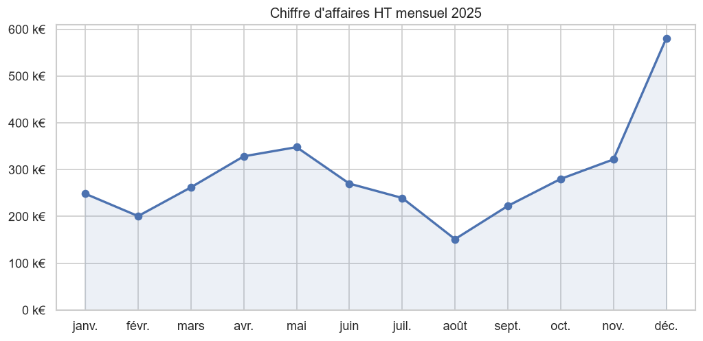
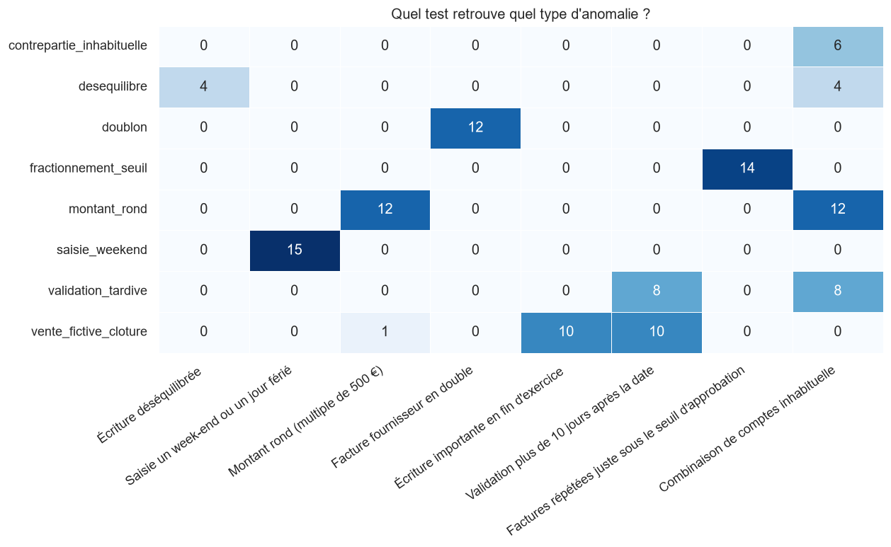
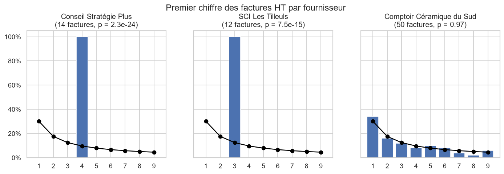

# 🔍 Détection d'anomalies dans les écritures comptables

> Projet de data analyse appliquée à l'**audit financier** : analyser un Fichier des Écritures Comptables (FEC) pour repérer les écritures à risque (erreurs, fraudes, contournement des contrôles).

🚧 *Projet en cours de construction*

## 🎯 Objectif

En audit, on ne peut pas contrôler les milliers d'écritures d'une entreprise une par une. Ce projet montre comment la data permet de :

- tester **100 % des écritures** au lieu d'un échantillon ;
- appliquer automatiquement les **tests d'audit classiques** (journal entry testing) ;
- repérer les montants suspects grâce à la **loi de Benford** ;
- attribuer un **score de risque** à chaque écriture grâce au machine learning.

## 🗺️ Étapes du projet

- [x] 1. Génération d'un FEC réaliste (données simulées, avec anomalies cachées)
- [x] 2. Exploration des données (volumes, comptes, saisonnalité) → [notebook](notebooks/01_exploration.ipynb)
- [x] 3. Tests d'audit : week-ends, montants ronds, doublons, déséquilibres, écritures de clôture → [notebook](notebooks/02_tests_audit.ipynb)
- [x] 4. Loi de Benford → [notebook](notebooks/03_benford.ipynb)
- [ ] 5. Score de risque par machine learning (Isolation Forest)
- [ ] 6. Restitution : application interactive et/ou rapport Power BI

## 📊 Les données

Les données sont **simulées** (aucune donnée réelle d'entreprise), mais respectent le format officiel du **FEC** exigé par l'administration fiscale française (18 colonnes, séparateur tabulation, article A47 A-1 du LPF).

**Entreprise fictive** : *Atelier Lumière SAS*, distributeur de luminaires, 18 salariés, exercice 2025.

| Indicateur | Valeur |
|---|---|
| Lignes d'écritures | ≈ 17 000 |
| Écritures | ≈ 6 650 |
| Chiffre d'affaires HT | ≈ 3,45 M€ |
| Marge brute / résultat avant impôt | ≈ 43 % / ≈ 6 % du CA |
| Journaux | Ventes, Achats, Banque, Paie, OD, À-nouveaux |
| Clients / fournisseurs | 40 / 26 |

Le flux est complet et cohérent : factures, règlements avec lettrage, paie mensuelle, TVA, emprunt, amortissements, saisonnalité (pic en fin d'année, creux en août). Les montants suivent naturellement la **loi de Benford**.

### Les anomalies cachées

**81 écritures anormales** ont été glissées parmi les ≈ 6 650 écritures (≈ 1,2 %). Elles reprennent des schémas de fraude et d'erreur classiques en audit :

| Anomalie | Nb | Ce que cela simule |
|---|---|---|
| Saisie le week-end | 15 | Écritures passées hors des heures habituelles |
| Fractionnement sous le seuil | 14 | Fournisseur fictif qui facture juste sous le seuil d'approbation de 5 000 € |
| Doublon | 12 | Même facture fournisseur saisie et payée deux fois |
| Montant rond | 12 | Sorties de banque rondes, au libellé vague (« Divers », « Ajustement »…) |
| Vente fictive en clôture | 10 | Chiffre d'affaires gonflé les derniers jours de l'exercice, jamais encaissé |
| Validation tardive | 8 | Avoirs antidatés, validés plusieurs mois après leur date |
| Contrepartie inhabituelle | 6 | Salaires payés directement par la banque, hors paie |
| Déséquilibre | 4 | Débit ≠ crédit (chiffres inversés à la saisie) |

La liste de ces anomalies (`anomalies_injectees.csv`) n'est **pas utilisée pour les détecter**. Elle sert uniquement à **mesurer l'efficacité** des tests d'audit, comme une correction d'examen.

Pour régénérer les données (résultat identique à chaque exécution) :

```bash
python src/generer_fec.py
```

## 🔎 Étape 2 : ce que révèle l'exploration

[Voir le notebook complet](notebooks/01_exploration.ipynb)

Avant tout test automatisé, une exploration bien menée fait déjà ressortir plusieurs zones de risque :

| Constat | Risque d'audit |
|---|---|
| 4 écritures déséquilibrées, avec des écarts tous **multiples de 9** | Inversions de chiffres à la saisie et contrôle logiciel défaillant |
| 15 écritures datées d'un **samedi ou d'un dimanche** | Saisie hors des circuits de contrôle |
| Les plus grosses factures impayées datent des **3 derniers jours de l'année**, avec des montants ronds, et ont été **validées en janvier** | Chiffre d'affaires fictif (*cut-off*) |
| Un fournisseur apparu en juin, **payé en 6 jours** contre 40 en moyenne, avec des factures proches de **5 000 € HT** | Fournisseur fictif, contournement du seuil d'approbation |

<p align="center">
  
  
</p>

## 🧪 Étape 3 : tests d'audit sur 100 % des écritures

[Voir le notebook complet](notebooks/02_tests_audit.ipynb) · [Code des tests](src/tests_audit.py)

8 tests de *journal entry testing* (ISA / NEP 240), chacun codé comme une fonction documentée et paramétrable :

| Test | Signalées | Précision |
|---|---|---|
| Écriture déséquilibrée | 4 | 100 % |
| Saisie un week-end ou un jour férié | 15 | 100 % |
| Montant rond (multiple de 500 €) | 14 | 93 % |
| Facture fournisseur en double | 12 | 100 % |
| Écriture importante en fin d'exercice | 13 | 77 % |
| Validation plus de 10 jours après la date | 19 | 95 % |
| Factures répétées juste sous le seuil d'approbation | 20 | 70 % |
| Combinaison de comptes inhabituelle | 31 | 97 % |

**Résultat :** sur 6 655 écritures, **91 sont signalées (1,4 %)**. Elles contiennent **les 81 anomalies cachées (rappel de 100 %)**, avec une **précision de 89 %**. Les 10 fausses alertes sont toutes explicables (dotation aux amortissements, grosses opérations légitimes de fin décembre…).

<p align="center"></p>

⚠️ **Limite assumée :** ces règles ont été conçues en connaissant les schémas injectés. Sur un vrai FEC, la précision serait plus faible, et un fraudeur averti peut éviter des règles connues. D'où les étapes suivantes : la loi de Benford et le machine learning non supervisé, qui ne partent pas d'une liste de fraudes connues.

## 🔢 Étape 4 : loi de Benford

[Voir le notebook complet](notebooks/03_benford.ipynb) · [Code](src/benford.py)

Le test des premiers chiffres ne part d'**aucune hypothèse sur la fraude**. Il utilise les indicateurs de référence en audit : MAD avec les seuils de Nigrini, khi-deux et test z.

- **Globalement**, le FEC est conforme à Benford (MAD = 0,0022) : 81 anomalies sur 17 000 montants ne déforment pas la distribution.
- **Le test des deux premiers chiffres** fait ressortir un pic sur « 57 » (z = 3,9). En creusant, un fournisseur y apparaît **40 fois plus que prévu** : c'est le fournisseur fictif.
- **Par fournisseur**, ses factures commencent toutes par 4 (p = 10⁻²⁴), alors qu'un fournisseur réel suit la courbe. Le loyer fixe s'écarte aussi de Benford, mais c'est une fausse alerte attendue : le jugement professionnel reste indispensable.
- **Les montants ronds** concentrent les alertes dans le journal des OD : 76 % de multiples de 100 €.

<p align="center"></p>

**Bilan :** Benford repère les montants **inventés ou répétitifs** (fractionnement, montants ronds), mais reste aveugle aux doublons, aux dates et aux schémas comptables. C'est donc un complément des tests d'audit, pas un remplaçant.

## 🛠️ Outils

Python · pandas · NumPy · SciPy · Matplotlib · seaborn · scikit-learn · Jupyter

## 📁 Structure

```
audit-anomalies-ecritures/
├── data/
│   ├── raw/          # données brutes (FEC)
│   └── processed/    # données nettoyées / enrichies
├── notebooks/        # analyses pas à pas
├── src/              # scripts Python réutilisables
├── reports/figures/  # graphiques exportés
└── requirements.txt  # bibliothèques nécessaires
```

## ▶️ Lancer le projet

```bash
python -m venv .venv
.venv\Scripts\activate
pip install -r requirements.txt
```

## 👤 Auteur

**Hélène Xavière** · [GitHub](https://github.com/helene-xaviere-Data)
