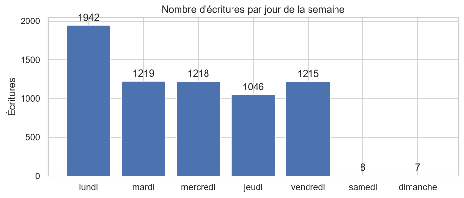

# 🔍 Détection d'anomalies dans les écritures comptables

> Projet de data analyse appliquée à l'**audit financier** : analyser un Fichier des Écritures Comptables (FEC) pour repérer les écritures à risque (erreurs, fraudes, contournement des contrôles).

🚧 *Projet en cours de construction*

## 🎯 Objectif

En audit, on ne peut pas contrôler les milliers d'écritures d'une entreprise une par une. Ce projet montre comment la data permet de :

- tester **100 % des écritures** au lieu d'un échantillon ;
- appliquer automatiquement les **tests d'audit classiques** (journal entry testing) ;
- repérer les montants suspects grâce à la **loi de Benford** ;
- attribuer un **score de risque** à chaque écriture grâce au machine learning.

## 🗺️ Étapes du projet

- [x] 1. Génération d'un FEC réaliste (données simulées, avec anomalies cachées)
- [x] 2. Exploration des données (volumes, comptes, saisonnalité) → [notebook](notebooks/01_exploration.ipynb)
- [ ] 3. Tests d'audit : week-ends, montants ronds, doublons, déséquilibres, écritures de clôture
- [ ] 4. Loi de Benford
- [ ] 5. Score de risque par machine learning (Isolation Forest)
- [ ] 6. Restitution : application interactive et/ou rapport Power BI

## 📊 Les données

Les données sont **simulées** (aucune donnée réelle d'entreprise), mais respectent le format officiel du **FEC** exigé par l'administration fiscale française (18 colonnes, séparateur tabulation, article A47 A-1 du LPF).

**Entreprise fictive** : *Atelier Lumière SAS*, distributeur de luminaires, 18 salariés, exercice 2025.

| Indicateur | Valeur |
|---|---|
| Lignes d'écritures | ≈ 17 000 |
| Écritures | ≈ 6 650 |
| Chiffre d'affaires HT | ≈ 3,45 M€ |
| Marge brute / résultat avant impôt | ≈ 43 % / ≈ 6 % du CA |
| Journaux | Ventes, Achats, Banque, Paie, OD, À-nouveaux |
| Clients / fournisseurs | 40 / 26 |

Le flux est complet et cohérent : factures, règlements avec lettrage, paie mensuelle, TVA, emprunt, amortissements, saisonnalité (pic en fin d'année, creux en août). Les montants suivent naturellement la **loi de Benford**.

### Les anomalies cachées

**81 écritures anormales** ont été glissées parmi les ≈ 6 650 écritures (≈ 1,2 %). Elles reprennent des schémas de fraude et d'erreur classiques en audit :

| Anomalie | Nb | Ce que cela simule |
|---|---|---|
| Saisie le week-end | 15 | Écritures passées hors des heures habituelles |
| Fractionnement sous le seuil | 14 | Fournisseur fictif qui facture juste sous le seuil d'approbation de 5 000 € |
| Doublon | 12 | Même facture fournisseur saisie et payée deux fois |
| Montant rond | 12 | Sorties de banque rondes, au libellé vague (« Divers », « Ajustement »…) |
| Vente fictive en clôture | 10 | Chiffre d'affaires gonflé les derniers jours de l'exercice, jamais encaissé |
| Validation tardive | 8 | Avoirs antidatés, validés plusieurs mois après leur date |
| Contrepartie inhabituelle | 6 | Salaires payés directement par la banque, hors paie |
| Déséquilibre | 4 | Débit ≠ crédit (chiffres inversés à la saisie) |

La liste de ces anomalies (`anomalies_injectees.csv`) n'est **pas utilisée pour les détecter**. Elle sert uniquement à **mesurer l'efficacité** des tests d'audit, comme une correction d'examen.

Pour régénérer les données (résultat identique à chaque exécution) :

```bash
python src/generer_fec.py
```

## 🔎 Étape 2 : ce que révèle l'exploration

[Voir le notebook complet](notebooks/01_exploration.ipynb)

Avant tout test automatisé, une exploration bien menée fait déjà ressortir plusieurs zones de risque :

| Constat | Risque d'audit |
|---|---|
| 4 écritures déséquilibrées, avec des écarts tous **multiples de 9** | Inversions de chiffres à la saisie et contrôle logiciel défaillant |
| 15 écritures datées d'un **samedi ou d'un dimanche** | Saisie hors des circuits de contrôle |
| Les plus grosses factures impayées datent des **3 derniers jours de l'année**, avec des montants ronds, et ont été **validées en janvier** | Chiffre d'affaires fictif (*cut-off*) |
| Un fournisseur apparu en juin, **payé en 6 jours** contre 40 en moyenne, avec des factures proches de **5 000 € HT** | Fournisseur fictif, contournement du seuil d'approbation |

<p align="center">
  
  
</p>

## 🛠️ Outils

Python · pandas · NumPy · Matplotlib · scikit-learn · Jupyter

## 📁 Structure

```
audit-anomalies-ecritures/
├── data/
│   ├── raw/          # données brutes (FEC)
│   └── processed/    # données nettoyées / enrichies
├── notebooks/        # analyses pas à pas
├── src/              # scripts Python réutilisables
├── reports/figures/  # graphiques exportés
└── requirements.txt  # bibliothèques nécessaires
```

## ▶️ Lancer le projet

```bash
python -m venv .venv
.venv\Scripts\activate
pip install -r requirements.txt
```

## 👤 Auteur

**Hélène Xavière** · [GitHub](https://github.com/helene-xaviere-Data)
